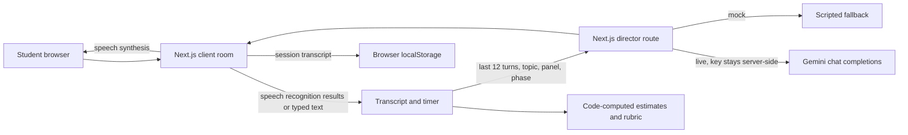

# GD Arena

## What it does

GD Arena is a voice-first practice room for campus placement group discussions. Students can practise with an AI panel, review a locally saved transcript, and see a transparent, code-computed practice rubric. **Problem Statement 2: GD Arena**

## Done / Left / Plan

**Done:** Next.js App Router and TypeScript app; 20 discussion prompts and a custom topic; 3–5 AI panelists plus an AI moderator; 5/8/10-minute sessions; standard, case, abstract, and debate formats; difficulty and language settings; browser speech input and speech output; typed fallback; turn-wise panel flow with one AI response after each student contribution; offline scripted demo; timer, pause, closing phase, transcript, estimate of word share, evidence-linked code rubric, local history/delete, and Markdown export. Gemini-compatible director API is server-only, bounded and schema-validated. Demo and mock modes are labelled.

**Left:** AI-generated post-session feedback and 2–3 transcript-specific missed-opening suggestions; director prefetch; retry-once behavior; 20-second silence invitations; richer interruption/disagreement measurement; Hinglish quality checks; more granular criterion scoring. The current rubric and advice are deterministic practice prompts, not an LLM assessment. The only interruption fact recorded is when mic capture begins during AI speech.

**Plan:** Prioritise transcript-grounded feedback, then run the manual browser checklist below, deploy to Vercel, and test the deployed API.

## Architecture and why



A single director call selects one panel speaker for each live AI turn and sees the topic, recent transcript, panel, phase, selected format, and difficulty. Panelists take turns: one responds after each student contribution, then the floor returns to the student. The `/api/director` route validates and bounds input/output with Zod, limits request body size, uses an 18-second provider timeout, and applies a process-local request throttle. The Gemini API key is read only by the server route. Gemini’s OpenAI-compatible endpoint keeps the provider adapter small; the chosen default is `gemini-3.6-flash`.

SpeechRecognition and SpeechSynthesis run in the browser where supported; the user can type and mute voices. Browser speech recognition may process audio according to the browser’s own service and settings. GD Arena does not upload or store raw audio. In live mode, transcript text is sent to the configured AI provider. Metrics and rubric evidence are computed from stored transcript turns in application code. Speaking share is estimated from word counts because browser speech recognition does not report audio duration. History uses localStorage so the prototype needs no account or database; it is limited to this browser and has a delete control.

## What we added

The room has five stable panel characters (Aarav, Riya, Kabir, Meera, and Dev), a live transcript filter, an optional mic access check, short typed turns, turn-wise panel replies, adjustable AI pause time, and a one-click demo that does not need an API key or internet. The demo uses scripted panel dialogue, is explicitly labelled, and requires the student to contribute before a report is produced.

The report displays exact transcript excerpts and links each rubric item to a transcript turn ID. Missing evidence is shown as “Insufficient evidence.” The numerical practice score is intentionally simple: 58 base points, plus 6 for each student turn, plus up to 12 from estimated speaking share, capped at 95. Treat it as a repeatable practice indicator, not a hiring assessment.

## How to run it

**Requirements:** Node.js 20.9 or newer and npm. In PowerShell:

```powershell
cd "$HOME\OneDrive\Desktop\gd-arena"
npm install
Copy-Item .env.example .env.local
notepad .env.local
npm run dev
```

Open `http://localhost:3000` in Chrome or Edge. The microphone is optional; if access is denied or recognition is unavailable, use the text box. `MOCK_LLM=true` forces the clearly labelled scripted API fallback. With `MOCK_LLM=false` and a valid `LLM_API_KEY`, the app uses Google Gemini. Gemini offers a free tier for some models and accounts/regions; quotas and model availability vary, so check [current Gemini API pricing](https://ai.google.dev/gemini-api/docs/pricing). Set `LLM_PROVIDER=gemini`, `LLM_API_KEY`, `LLM_MODEL=gemini-3.6-flash`, and `LLM_BASE_URL=https://generativelanguage.googleapis.com/v1beta/openai`. Create a key in [Google AI Studio](https://aistudio.google.com/app/apikey). Keep the key in `.env.local`; never put it in a `NEXT_PUBLIC_` variable.

The live URL is **not deployed**; this repository currently runs locally. To deploy, import this repository into Vercel, add the four Gemini environment variables in the project settings, leave `MOCK_LLM=false`, deploy, and test the room on the generated HTTPS URL. HTTPS is needed for microphone access.

Useful commands:

```powershell
npm run lint
npm run typecheck
npm run test
npm run build
npm start
```

## Tools and AI used

Next.js App Router, React, TypeScript, Tailwind CSS 4, Zod, Vitest, ESLint, and Prettier. The live provider adapter uses Google Gemini through its OpenAI-compatible REST endpoint; the default model is `gemini-3.6-flash`. Browser voice input and output use the Web Speech APIs. The room, setup, report, and landing page state that participants and the moderator are AI. The UI distinguishes `LIVE AI`, `MOCK SESSION`, and `DEMO SESSION`; scripted fallback text is not presented as live reasoning.

**Privacy and security:** no user account or personal profile is collected; session transcripts are stored in browser localStorage until deleted. `.env.local` is ignored by Git. Provider secrets remain server-side. Request fields and model output are validated, transcript and body sizes are capped, and provider requests time out. The in-memory throttle is per server process and is not a substitute for a managed production rate-limit service. Gemini free-tier data-use terms may differ from paid tiers; review the provider’s current terms before sending sensitive transcript text.

**Known limitations:** this is a prototype. AI post-session feedback is not implemented; the rubric is heuristic and uses transparent evidence-presence signals rather than quality scores. A local browser smoke test verified the landing, setup, four-person demo room, typed student input, report, and evidence navigation. A 390×844 viewport check had no horizontal overflow. Keyboard-only, real microphone permission, provider failure, offline, refresh, and deployed-provider tests remain outstanding. Browser speech voices and speech recognition availability vary. Recognition language is `en-IN`; Hinglish output quality is not guaranteed. Speech timing, interruption duration, and silence are not measured. The director does not prefetch. The browser retries once after a failed request, then uses a short persona line and a warning. Local history is browser-specific and capped at 30 sessions.

**Checks run for this revision:** `npm run lint` (pass, no warnings), `npm run typecheck` (pass), `npm run test` (10 tests pass across 2 files). `npm run build` (pass, optimized production build completed).

**Manual checklist before presenting:**

- [ ] Deny microphone permission; continue by typing.
- [ ] Use a browser without SpeechRecognition; confirm typed flow.
- [ ] Start mic while AI speech is playing; confirm speech stops and turn is marked interrupted.
- [ ] Simulate provider failure or bad key; confirm fallback warning and no crash.
- [ ] Pause and resume; confirm timer freezes and resumes.
- [ ] Refresh during a session; confirm graceful reset and saved history remains.
- [ ] Disconnect the network; confirm the scripted demo still works.
- [ ] Check a narrow phone viewport, keyboard tab order, visible focus, and screen-reader transcript updates.
- [ ] With a live Gemini key, verify the setup disclosure, AI response, and that no key appears in browser network payloads.

**Three-minute demo script:** Click **Start Demo**. Wait for the AI moderator’s opening, type one concise position in the room, and let two or three different AI panelists respond. Click **End session & view report**, point to the estimated word-share chart and rubric excerpts, open the transcript evidence, then open **Your sessions** and delete the demo record.

## Who it is for

College students preparing for campus placements who want a low-pressure way to practise speaking, listening, and taking turns before a real group discussion. A repeat visit lets them compare a new transcript against their own recent practice, on the same device.
